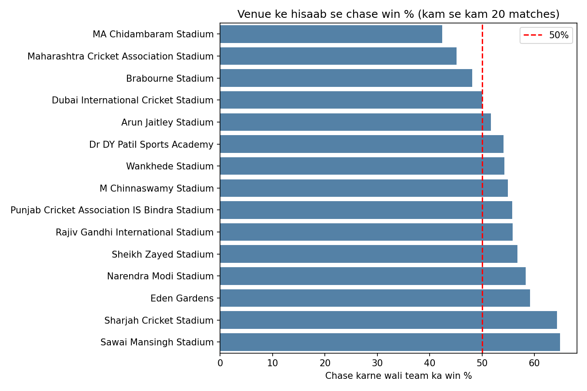
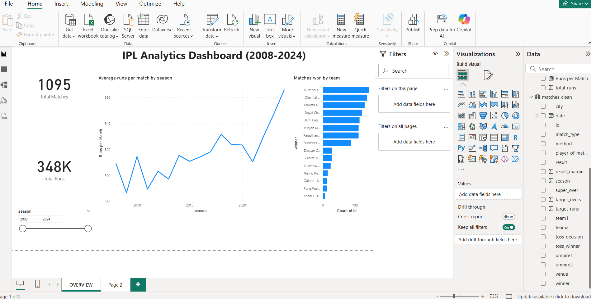
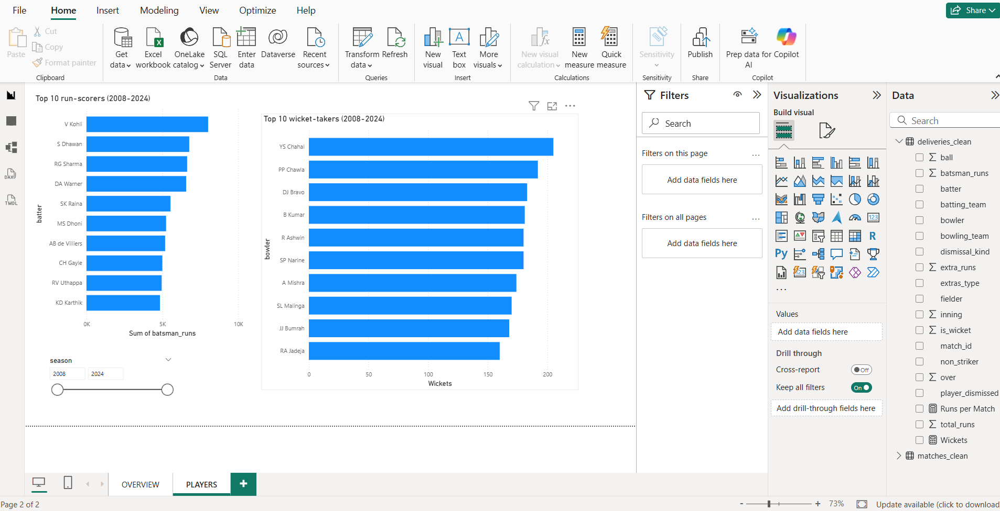

# IPL Analytics (2008-2024)

Analysis of 17 IPL seasons using Python, SQL and Power BI.

**Data:** Kaggle IPL dataset, 1,095 matches and 260,920 deliveries.
**Tools:** Python (Pandas, Matplotlib, Seaborn), SQLite, Power BI, Git

## What I did
- Cleaned the data: unified team names, fixed season labels, merged duplicate venue names (58 to 36) and filled missing cities.
- Explored toss, venue, batting and bowling stats in Python.
- Wrote SQL queries (CTE and window functions) for champions, player of the match and top scorer per season.
- Built a 2-page Power BI dashboard with a season slicer.

## Findings
- Toss winners won 50.8% of matches, so the toss alone doesn't decide much. Teams that chose to field won 53.9% vs 45.4% for teams that chose to bat (this is correlation only).
- Chasing teams won 54.1% overall. Jaipur favours chasing (64.9%), Chennai favours defending (chase win rate 42.4%).
- Kohli has the most runs (8,014) and Chahal the most wickets (205).
- Mumbai and Chennai have 5 titles each.
- Average runs per match went from about 287 in 2009 to about 366 in 2024.

## Visuals

Aniket | [GitHub](https://github.com/aniket78981)
